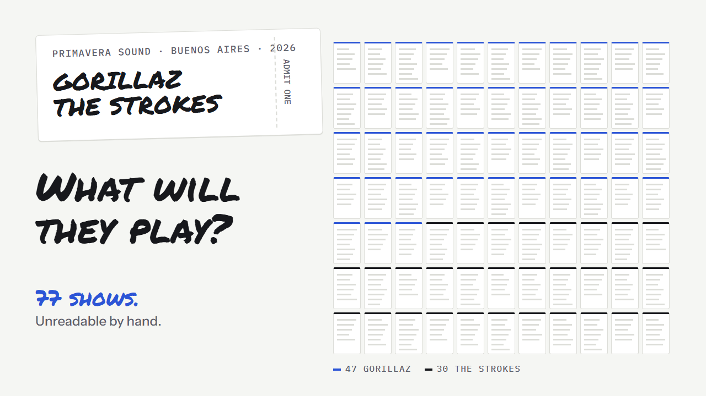
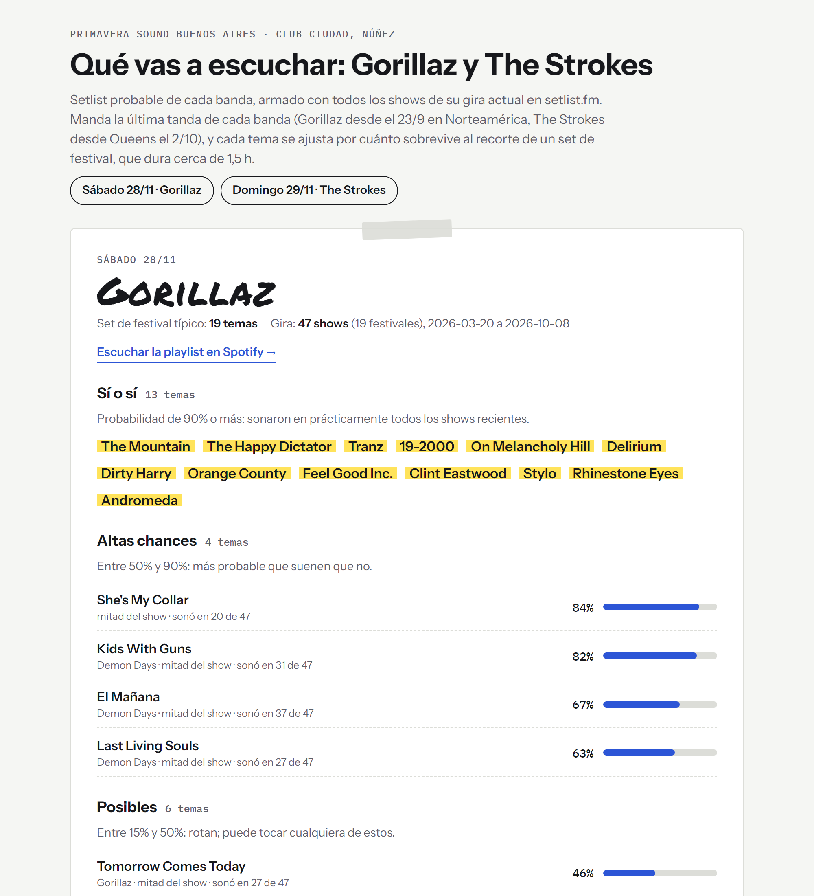

# setlist-predictor

What will Gorillaz and The Strokes play at Primavera Sound Buenos Aires 2026? This repo answers that from every show
of their current tours, and turns the answer into two Spotify playlists in show order.

[](docs/hyperframes/setlist-predictor.mp4)

**Listen:** [Gorillaz](https://open.spotify.com/playlist/1IZqWbRl3vrWjZFqOdAwP4) ·
[The Strokes](https://open.spotify.com/playlist/0G2lE83qb30uNAfjGXIZ3Y)

> **This is an example export.** The working project lives in my private workspace. This copy was cleaned up for
> sharing: personal references removed, code and docs translated to English. The report stays in Spanish on purpose:
> it was made for me, a festival-goer in Buenos Aires.



## Why this exists

I have a ticket for both nights. I wanted to know what I'm likely to hear, and to listen to it while I wait.

Doing it by hand meant reading 77 setlists, noticing which songs rotate, which ones get cut at festivals, and which
ones always come back to back. Not worth an afternoon. Worth an hour of directing an agent.

**The first working version, playlists included, took under an hour. Everything after that was iteration.**

The code doesn't matter much here. What this repo shows is the process: how the work was briefed, split, checked and
steered.

## How it was built

### 1. One session wrote the brief, another one built it

I described what I wanted to a Claude Code session. Instead of building it, that session wrote a brief
([`SPEC.md`](SPEC.md), translated from Spanish, otherwise as handed over): the decisions already made, the
deliverables, the data rules ("ALL the data, no summarizing or sampling"; a show that can't be downloaded "is recorded
as missing, never made up"), and when to stop and ask me. A second session took the brief and built the pipeline from it.

Splitting it this way keeps the builder's context clean, and makes every decision explicit before any code exists.

### 2. Receipts: what changed after the first version

Each of these was a short note from me. Each one changed the data, not just the code.

| My note | What changed |
|---|---|
| "I want to hear everything I'm quite likely to hear" | The 30-song cap from the brief went away. The playlist now takes every song with at least 15% probability, plus anything in half the current repertoire. |
| "Only the last 4 to 10 shows really matter" | The model weights tour legs. Gorillaz's set locked in after 9/23, so those 10 shows weigh 4x. |
| "Add filler from Demon Days and Plastic Beach, not the debut" | Songs from those albums that rotate in recent shows fill the playlist up to 150 minutes. |
| "Does either band have a feature with someone playing the same day?" | Checked against both lineups: no. But the data showed something else: **Trueno**, who raps on Gorillaz's *The Manifesto*, joined them on stage in 8 of the 9 shows where it was played. He's from Buenos Aires. *The Manifesto* went into the playlist. |
| "Now the reverse: downweight songs that were played because a guest was around" | Songs played almost only with an occasional guest now count 25%. *Garage Palace* (Little Simz, 14 of 14 plays) and *Rock the House* (Del the Funky Homosapien) dropped out of the playlist. Guests who tour with the band (Bootie Brown, Kara Jackson, Posdnuos) don't count as occasional. |

### 3. The video, with its own receipts

The video at the top is code too: an HTML composition rendered frame by frame with the
[HyperFrames](https://github.com/heygen-com/hyperframes) CLI. It came from one directed prompt, written in numbers
instead of adjectives ([`story/PROMPT.md`](story/PROMPT.md)), and 10 creative follow-ups: 9 from Claude reviewing its
own frames, and 1 from me ("It's missing the most important thing: the playlist"). A plain HTML + Playwright build of
the same prompt was made in parallel and dropped for its weaker motion. Every follow-up, as acted on:
[`story/hyperframes/RECEIPTS.md`](story/hyperframes/RECEIPTS.md).

### 4. What the agent did, and what I did

The code was written by Claude (Claude Code, Opus 5.5). I set the goal, made the calls in the table above, and
checked the results against what I know about these bands. Data sources were checked live: setlist.fm's API for the
shows, the festival's lineup per day from the press.

## How it works

- **Data:** `build_db.py` pulls every show of each band's current tour from the setlist.fm API into SQLite.
- **Model:** `analyze.py` computes, per song, *current repertoire × festival factor*. The repertoire weights the most
  recent shows; the festival factor measures how often a song survives the cut at festivals compared with nearby
  headline shows. Order comes from pairwise comparisons (Copeland) plus the fixed transitions of the latest shows.
- **Output:** `RESULTS.md` (patterns, probable setlists, playlists), `REPORT.md` and `report.html` (a readable report,
  in Spanish), and two Spotify playlists via `spotify.py`.

Full method: [`METHOD.md`](METHOD.md). Results as of 2026-10-11: [`RESULTS.md`](RESULTS.md), [`REPORT.md`](REPORT.md).

## How to use it

This isn't an app you run by hand. It was designed to be operated by an LLM coding agent (I use Claude Code): you open
the folder, ask in plain language, and the agent runs the scripts, reads the results and edits the model when the tours
change. The scripts are the agent's tools; `METHOD.md` is how it knows what the model does.

Things I ask it:

- *"Update the setlists."* It re-downloads the tours, recomputes, refreshes both playlists and regenerates the report.
- *"The Latin American leg started, add it."* New shows outside the configured legs stop the model on purpose
  ("outside the legs in BANDS; add the new leg"): the agent reads the new dates and extends `BANDS` in `analyze.py`.
- *"Did anyone join them on stage in the new shows?"* It checks the guests in the data before the guest rule touches
  the playlist.

<details>
<summary>Running it by hand</summary>

Python 3.10+, standard library only.

```
# .env with SETLISTFM_API_KEY=... (free key from setlist.fm) and SPOTIFY_CLIENT_ID=... (a Spotify app
# with Redirect URI http://127.0.0.1:8888/callback)
python build_db.py          # downloads the tours into setlists.db
python analyze.py           # RESULTS.md and playlists.csv
python spotify.py login     # once
python spotify.py links     # finds every song on Spotify
python analyze.py           # again, now with links
python spotify.py create    # creates the two playlists in your account
python report.py            # REPORT.md and report.html
```

`update.bat` runs the whole chain on Windows.

</details>

## Data

Setlists come from [setlist.fm](https://www.setlist.fm) and are not redistributed here: `build_db.py` downloads them
with your own API key.

## License

[MIT](LICENSE).
